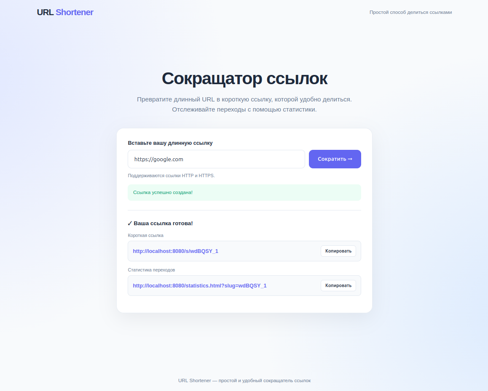
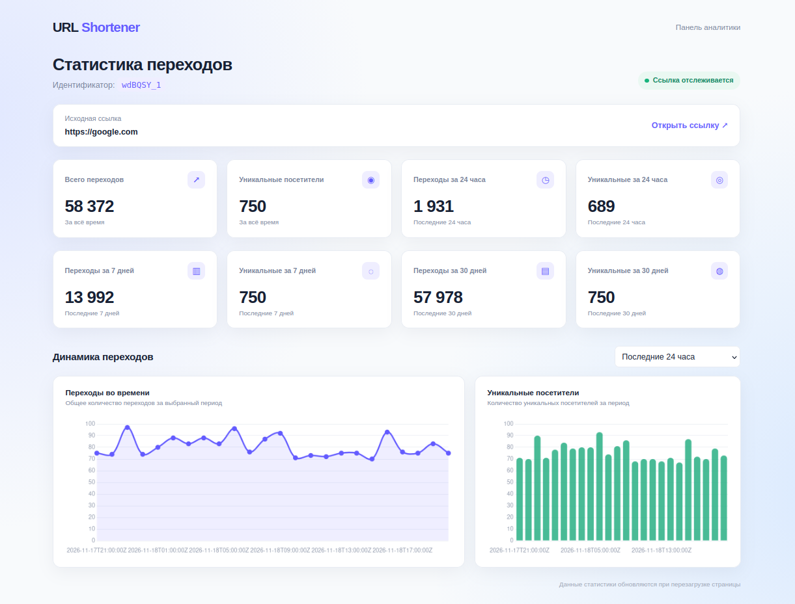

# URL Shortener API

## Описание проекта

Сокращатор ссылок - веб-приложение для сокращения ссылок со статистикой перехода по ссылкам.

Стек: Бекенд - Golang, Фронтенд - JS, HTML

Пакеты Golang которые используются в проекте:

- net/http
- database/sql
- pgx (драйвер для PostgreSQL)
- golang-migrate (для миграций)
- go-redis/v9 (для Redis)

### Сокращение ссылки 

Хотим длинную ссылку превратить в короткую:

```
https://somesite.com/path/path2/path3/path4?param1=value1&param2=value2&param3=value3
```

Сервис сделает её короче:

```
https://service.com/Idhfayr73e
```

Если переходить на короткую ссылку, то сервис будет редиректить пользователя на основную ссылку.

### Скриншоты

#### Главная страница



#### Статистика



### Запуск проекта через Docker Compose

Windows:

```
docker-compose up -d
```

Linux:

```
docker compose up -d
```

### API Docs

GET `/` - фронтенд

POST `/api/short` - сокращает переданную ссылку, возвращает slug для короткой ссылки. В body необходимо передавать url который нужно сократить.

Пример body:
```
{ "url": "https://google.com" }
```

Пример ответа:

```
{ "text":"IziXC5Az", "number": 2 }
```

GET `/s/{slug_text}_{slug_number}` - делает редирект на ссылку к которой привязан slug.

#### Статистика

GET `/api/statistics/{slug_text}_{slug_number}` - возвращает общую статистику по требуемому slug.

```
{
  "total":1,
  "unique":1,
  "total_24h":1,
  "total_7d":1,
  "total_30d":1,
  "unique_24h":1,
  "unique_7d":1,
  "unique_30d":1
}
```

GET `/statistics.html?slug={slug_text}_{slug_number}` - возвращает страницу со статистикой по требуемому slug.
